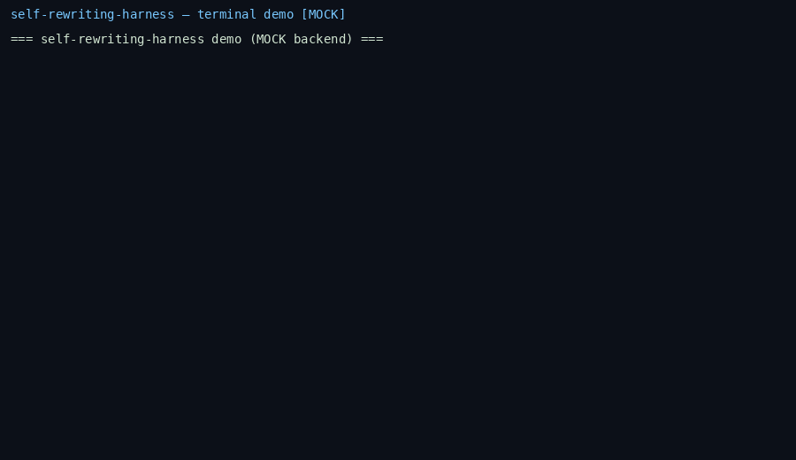

# self-rewriting-harness

<p align="center">
  <strong>An open agent runtime that rewrites its own harness from failure traces — and only keeps edits that win on held-out tasks.</strong>
</p>

<p align="center">
  <a href="#quick-start">Quick start</a> •
  <a href="#demo">Demo</a> •
  <a href="#how-it-works">How it works</a> •
  <a href="docs/RELATED_WORK.md">Related work</a> •
  <a href="docs/REPORT.md">Design report</a>
</p>

---

## What’s different?

Recent **self-improving agent** systems (Darwin Gödel Machine, ADAS, Self-Harness, VERSE) rewrite prompts, tools, or code from experience. **self-rewriting-harness** v1 focuses on three practical choices:

| Idea | This repo |
|------|-----------|
| **Object of evolution** | Git-versioned **`harness/`**: `SYSTEM_PROMPT.md`, `checks.yaml`, and a **57-skill** [`harness/skills/`](harness/skills/) library (seed tarball) |
| **Acceptance test** | **Held-out gate** — a candidate edit is committed only if score on `tasks/heldout/` does not regress |
| **Regression ablation** | **`ungated`** mode accepts every edit (mock backend can inject a held-out-breaking token to show drift) |
| **Repro without API keys** | Deterministic **`MOCK`** backend; CI runs the **full** loop and labels all metrics **MOCK** |

See [docs/RELATED_WORK.md](docs/RELATED_WORK.md) for DGM, ADAS, Voyager, and 2026 harness-optimization papers.

## Demo

Terminal-style evolution (accept + rollback) recorded with the **MOCK** backend:



Regenerate:

```bash
pip install -e ".[dev]"
python3 scripts/make_demo_gif.py
```

## How it works

```text
tasks/train ──► runtime (failures) ──► proposer ──► candidate edit
                                                      │
tasks/heldout ◄── critic (gate / rollback) ◄──────────┘
                      │
                      ▼
              git commit in harness/  (or revision_log.jsonl)
```

- **`runtime/`** — task runner, checkers, failure traces, pluggable backends (`mock`, OpenAI-compatible, Anthropic).
- **`proposer.py`** — proposes minimal harness diffs from a failure trace.
- **`critic.py`** — `gated` | `ungated` | `frozen` modes; git commit on accept.
- **`tasks/train`** & **`tasks/heldout`** — small YAML tasks with automatic `ANSWER:` checkers.

**Hypothesis (v1):** under equal generation budget, **gated** evolution beats a **frozen** harness on held-out tasks; **ungated** self-edit regresses when bad edits are accepted.

## Quick start

```bash
git clone https://github.com/Sebastianrodaaa/self-rewriting-harness.git
cd self-rewriting-harness
pip install -e ".[dev]"

# Full mock evolution (frozen + gated + ungated) + plot
bash scripts/run_mock_demo.sh
```

Outputs (all **MOCK** unless you use a live backend):

- `results/evolution_{frozen,gated,ungated}.json`
- `results/heldout_generations.png`

### Live models (requires API keys)

```bash
export OPENAI_API_KEY=...          # or ANTHROPIC_API_KEY=...
bash scripts/run_real.sh
```

Never commit keys. Live runs are **not** labeled MOCK in `label_note`.

### CLI

```bash
export SRH_BACKEND=mock   # default
python3 -m runtime.cli eval --split heldout
python3 -m runtime.cli evolve --mode gated --generations 8
python3 -m runtime.cli evolve --all --generations 8
```

| Variable | Purpose |
|----------|---------|
| `SRH_BACKEND` | `mock` (default), `openai`, `anthropic` |
| `OPENAI_API_KEY` / `OPENAI_BASE_URL` / `OPENAI_MODEL` | OpenAI-compatible chat |
| `ANTHROPIC_API_KEY` / `ANTHROPIC_MODEL` | Anthropic messages API |
| `SRH_PROPOSER_NOISE` | Set to `1` for ungated ablation noise (mock) |

## Project layout

```text
harness/           # Evolving system prompt, checks, 57 skills (+ MANIFEST)
runtime/           # Task runner, backends, evolution entrypoints
proposer.py        # Failure → edit
critic.py          # Held-out gate + ablations
tasks/train|heldout/
results/           # Metrics JSON + plot (MOCK in CI)
scripts/           # run_mock_demo.sh, run_real.sh, plot, demo GIF
docs/              # RELATED_WORK.md, REPORT.md, demo.gif
tests/             # pytest + GitHub Actions
```

## Skill library

Seed skills live under [`harness/skills/`](harness/skills/). [`MANIFEST.md`](harness/skills/MANIFEST.md) lists included skills and **excluded** upstreams (noncommercial / AGPL / unknown license). This library is what the evolution loop edits.

## Development

```bash
python3 -m pytest -q
python3 -m ruff check .
```

## License

MIT — see [LICENSE](LICENSE). Seed skills carry upstream terms noted in `MANIFEST.md`.

## Acknowledgments

README structure inspired by [awesome-readme](https://github.com/matiassingers/awesome-readme). Related systems: [DGM](https://arxiv.org/abs/2505.22954), [ADAS](https://arxiv.org/abs/2408.08435), [Voyager](https://arxiv.org/abs/2305.16291).
