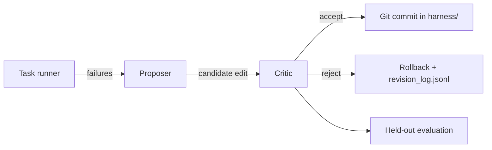

# Design report (v1)

## Goal

Build an **open agent runtime** that improves its **harness** (system prompt, checks, and a library of SKILL.md files) from **failure traces**, while **rejecting edits** that hurt performance on **held-out tasks** the proposer never trains on directly.

## Architecture

1. **runtime/** — loads tasks, assembles harness text, calls a **pluggable backend**, runs checkers, emits traces.
2. **proposer.py** — maps a failure trace to a minimal edit (append to `SYSTEM_PROMPT.md` or a skill file). With `SRH_BACKEND=mock`, behavior is **deterministic** for CI.
3. **critic.py** — modes:
   - **gated** — accept iff held-out score ≥ pre-edit score;
   - **ungated** — always accept (ablation; mock proposer may inject a held-out-breaking token);
   - **frozen** — never accept (baseline).
4. **harness/** — versioned with **git** inside each evolution worktree; `revision_log.jsonl` records rejected proposals.

## Task suite

- **tasks/train/** — five YAML tasks (math, JSON, reasoning).
- **tasks/heldout/** — five disjoint YAML tasks.
- Checkers require an `ANSWER:` line with exact match to `expected`.

The mock backend succeeds when required **mock_tokens** appear in the assembled harness text. This is a **test double**, not a claim about LLM capability. All CI artifacts label **MOCK**.

## Hypothesis (v1)

Under equal generation budget:

1. **Gated evolution** achieves higher **held-out** score than a **frozen** harness.
2. **Ungated** self-edit achieves high train fit but **lower or equal held-out** score when harmful edits are accepted (mock noise token ablation).

Real-model behavior requires running `scripts/run_real.sh` with API keys; numbers are **not** fabricated in documentation.

## Threats to validity

| Threat | Mitigation / note |
|--------|-------------------|
| Mock backend ≠ LLM | Clearly labeled; `run_real.sh` for reproduction with keys |
| Tiny task count | v1 proves plumbing; not a benchmark paper |
| Proposer sees held-out failures after train solved | Held-out traces drive **proposals** only after train is clean; **critic** always scores held-out before accept |
| Skill library truncation | v1 loads full skill text into context (large but faithful) |
| License mix in seed skills | Non-redistributable skills excluded; see `harness/skills/MANIFEST.md` |
| Git history in worktrees vs main harness | Evolution copies seed harness to `results/.work/<mode>` to avoid mutating repo checkout during experiments |

## Future work

- Trace clustering (Self-Harness-style weakness mining).
- LLM proposer with structured diff instead of append-only v1.
- Larger held-out suites and cross-model replication tables in `results/`.
